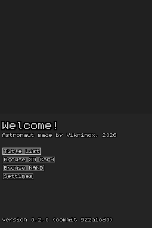
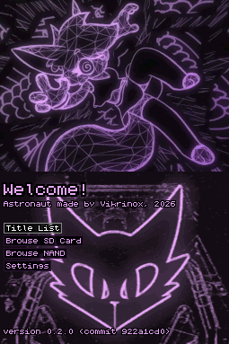
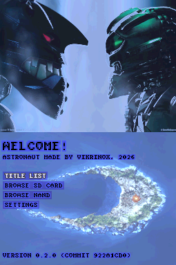

# Astronaut
Astronaut is a custom stage2 firmware made exclusively for DSi consoles. Which is an alternative to Nocash's Unlaunch. 
It uses the same primary exploit as unlaunch, wherein it hijacks the console while loading the TMD data for the DSi Menu. Unlocking all features of the console for homebrew use.

## Licensing
Astronaut is primarily licensed under the GPL version 3 license, with exception to the cargo crates found in the `crates` directory of this repository. These crates instead use the MIT license. For specifics, please check the top of a given source file to know it's licensing. Or the ``Cargo.toml`` file for the respective crate.

## Features
* Launch DSi Compatible Homebrew and DSiWare software from the DSi SD card and DSi NAND
* A tiny file explorer GUI with touchscreen and themeing support 
* Selective Autobooting via button combos during reset/startup
* Patching of the DSi menu to nullify any anti-tampering and region locking checks. (Currently required)

## Configuration
Astronaut can be configured with settings found in two locations; ``sdmc:/_nds/astronaut/settings.ini``, and ``nand:/astronaut.ini``. If none of these are found, the defaults are selected. When saving both locations are written to as available, and when loading the settings on the SD card has priority.

## Themes
It is possible to style the astronaut GUI with the help of themes. These are centered around arbitrarily placed `.ini` file. Once selected from the gui it will automatically be applied. (Just remember to save your settings!)

Credit goes to convexity, caikslyce, and the lego group for various assets used in these custom themes.

## Limitations
* Older and more obscure homebrew may not work due to complications with the loader. In these cases, chainload them from your homebrew menu of choice instead.
* DS Mode ROMs have no audio, as the codec chip isn't initialized for them yet. This can also be fixed by simply using your homebrew menu of choice instead.
* Wifi initialization is unstable. (Use the `Enable Wifi` option to toggle it)

### Known problematic titles
The below apps are known to have issues, in case of DSiWare it is usually fixed by simply launching it from the DSi home menu instead (or a DSiWare compatible homebrew menu)
* DSi System Settings - Shows ``An Error Has Occured.``
* DSi Shop - Shows ``An Error Has Occured.``
* DSi Sound - Randomly doesn't boot, and has a chance of deleting it's save if it does
* Rayman (DSiWare) - Crashes on save points, shows corrupted graphics on title screen
* Mario VS DK minis march again - top screen while loading shows the wrong graphics
* Brain Age Express: Sudoku - Shows garbage on bottom screen during ESRB splash
* GodMode9i - NAND drive fails to mount (relaunch godmode9i from within itself and the problem is fixed) 

## State of the project (Last updated 2026-10-20)
Currently, while Astronaut is adequate for casual users, i (vikrinox) do not personally deem it ready for a full 1.0 release as of right now. Mainly since the DSi menu still requires patching to function.

## Compiling yourself
Due to the complexity of building DS binaries from rust, the main crate of this repository is actually a builder program, as opposed to the code which will run on the DSi. You will instead find this in the `astronaut` folder of the repository. 

When compiling Astronaut yourself you will need the following installed:

* the rust programming language (rustc, cargo, etc.) and the ``rust-src`` component
* a suitable C/C++ compiler for the fatfs dependency. (this will be searched for by the build program)
* the `lld` linker 
* the `arm-none-eabi-gcc` compiler.  
* ``git`` version control. (used to generate git hash for main menu)

Once rust and the other dependencies are installed, compiling *should* be as simple as running `cargo run`. Optionally, you can provide a number of command line arguments to change how astronaut is compiled. For information, use ``cargo run -- --help``. (NOTE: the first set of ``--`` means we're finished providing command line arguments for cargo, and everything thereafter goes to the compiled build program.)

## Compatability with Unlaunch (and the a+b combo)
In order to make sure there is not a sea of chaos within the DSi Modding community, the `a+b` button combo is fixed to start Astronaut's gui.

Astronaut also supports unlaunch's "autoload" API. Meaning that options for loading DS homebrew with unlaunch will (in most cases) be redirected to Astronaut accordingly.

## Compatability with slot-1
There is no support for launching the cartridge inserted into slot-1 from the Astronaut gui. Instead, it is recommended to autoboot the DSi Menu or a homebrew slot-1 launcher to get this functionality. 

## Contributing and AI
Contributions are very welcome. Astronaut is ultimately built for the DSi modding community, and i see no reason to gatekeep it. However i do not appreciate the use of generative AI in this project, as i question the ethics of current AI companies and a significant portion of vibecoders. Exceptions can be made in cases where the AI use is properly disclosed, confirmed to be human reviewed as well as overseen by me, and is of little significance to the resulting PR. If one is caught trying to hide the fact they used AI they will no longer be permitted to contribute to this project

To enforce this stance the project makes use of [no-agents.md](https://codeberg.org/rossabaker/no-agents.md), alterations to these files in your PR will mean an automatic rejection.